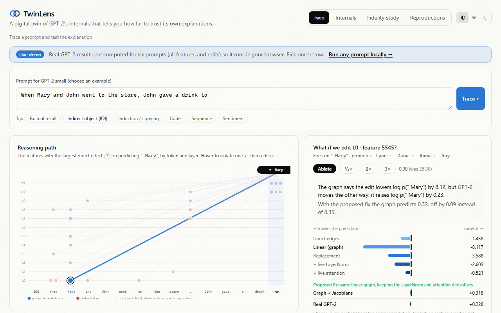
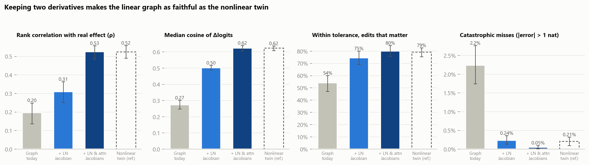

# TwinLens

[](https://github.com/SpiliosDimakopoulos/twinlens/actions/workflows/ci.yml) [](https://spiliosdimakopoulos.github.io/twinlens/) [](https://doi.org/10.5281/zenodo.23437556) [](https://colab.research.google.com/github/SpiliosDimakopoulos/twinlens/blob/main/notebooks/audit_your_prompt.ipynb)

**Do attribution graphs predict what a language model actually does?** An attribution graph
explains a prediction with arrows: "this internal feature pushes the answer up by this much".
TwinLens tests those arrows. For each one it switches the feature off in GPT-2 and compares the
graph's predicted effect with the real one.

On 8,064 such edits the graph is often wrong, sometimes in the opposite direction. Most of the
error comes from two parts of the model that the graph holds fixed, LayerNorm and attention.
Adding their first-order response back keeps the graph linear and raises its rank agreement
with GPT-2 from ρ = 0.20 to 0.53. The result replicates on Qwen3-0.6B.



*In the IOI prompt above, today's attribution graph predicts that switching off one feature
lowers the probability of "Mary" by 8.1 nats. GPT-2 actually raises it by 0.23. The same linear
graph with the two derivatives restored predicts +0.32.*

## Try it

**In the browser:** the [live demo](https://spiliosdimakopoulos.github.io/twinlens/) runs on
precomputed GPT-2 runs. Click a dot in the graph and compare each prediction with what GPT-2 did.

**On your own prompt, in Colab:** [`notebooks/audit_your_prompt.ipynb`](https://colab.research.google.com/github/SpiliosDimakopoulos/twinlens/blob/main/notebooks/audit_your_prompt.ipynb)
(free CPU runtime, about five minutes including downloads).

**From a terminal:**

```bash
pip install torch --index-url https://download.pytorch.org/whl/cpu   # CPU build, ~200 MB
pip install "twinlens @ git+https://github.com/SpiliosDimakopoulos/twinlens"
twinlens audit "When Mary and John went to the store, John gave a drink to"
```

The first run downloads GPT-2 small (0.5 GB) and its 12 transcoders (1.8 GB) from the Hugging
Face Hub into `~/.cache/twinlens` (set `TWINLENS_CACHE` to move it). `twinlens audit` checks the
strongest arrows of the graph and prints one row per arrow:

```
layer word         feature    graph    fixed    GPT-2  graph verdict   fixed verdict   trust
    0  Mary           5545   -8.117   +0.318   +0.228  WRONG SIGN      ok                 7%
   10  to            13585   +0.014   +0.031   +0.032  understated     ok                98%
    7  Mary          12771   -0.186   +0.032   +0.034  WRONG SIGN      ok                81%
  ...
Today's graph is off on 3 of 8 edges; with the fix, 0 of 8.
```

- **graph**: today's attribution graph (LayerNorm and attention frozen);
- **fixed**: the same linear graph with the LayerNorm and attention derivatives kept;
- **GPT-2**: the real model with the edit applied;
- numbers are the change in log-probability of GPT-2's answer (−1 ≈ 2.7× less likely);
- **trust** estimates, from the unedited run only, how likely the graph's number is to be close.
  It was fitted on ablations and ×2 edits of this study's prompts; treat it as a warning light,
  not a probability you can bank on.

Add `--json` for machine-readable output and `--top 20` for more arrows.

## Results

From 8,064 edits on GPT-2 small (56 prompts, 8 task families). Full write-up:
[report](https://spiliosdimakopoulos.github.io/twinlens/report/) ([PDF](docs/TwinLens_report.pdf)).

| | today's graph | gradient through real GPT-2 | with the fix |
|---|---|---|---|
| rank agreement with the real effect (Spearman ρ) | 0.20 | 0.38 | 0.53 |
| right direction, on edits that move the answer | 67% | 77% | 86% |
| badly wrong (off by more than 1 nat) | 2.2% | 0.1% | 0.05% |

- **Why the graph fails.** Frozen LayerNorm causes most of the error and nearly all large
  misses, almost all of them for edits in the first three layers. Frozen attention causes most
  of the ranking error.
- **The fix.** Keeping the LayerNorm and attention-softmax Jacobians gives a graph that is still
  linear and matches the nonlinear twin. It also ranks and signs effects better than attribution
  patching, a gradient through the real model (Δρ +0.15 [0.11, 0.19]). On Qwen3-0.6B the gain
  over today's graph is smaller but holds on every metric (Δρ +0.12 [0.05, 0.20]). IOI prompts
  go from ρ 0.01 to 0.59.
- **Spotting bad predictions.** A logistic model over nine signals from the unedited run flags
  failures with AUROC 0.84 on edits that move the answer. Disagreement between today's graph
  and the fixed graph is an even better warning (0.94).
- **Upstream.** The fix is proposed to the open-source
  [circuit-tracer](https://github.com/decoderesearch/circuit-tracer) library as opt-in flags
  ([PR #123](https://github.com/decoderesearch/circuit-tracer/pull/123), under review).

<p>
  
</p>

## Limitations

- Two small models (GPT-2 small; Qwen3-0.6B, upper 18 layers only) and per-layer transcoders.
  Cross-layer transcoders, used by the current circuit-tracing work, are untested.
- 56 short prompts written by the author; one prediction target per prompt.
- Only feature-to-output effects are measured, not feature-to-feature edges.
- Most edits change the answer very little; the rank and sign results are the robust ones.

Details and the remaining caveats are in §5 of the [report](https://spiliosdimakopoulos.github.io/twinlens/report/).

## How it works

GPT-2 runs on a ~250-line PyTorch implementation with hook points
([`twinlens/core/gpt2.py`](twinlens/core/gpt2.py)); its logits match Hugging Face to 7×10⁻⁵.
Before measuring anything new it reproduces known GPT-2 circuits (induction heads, the IOI name
movers, the sites of factual recall), each pinned as a test. MLPs are replaced by the
transcoders of Dunefsky, Chlenski & Nanda (2024) plus a fixed error term, and five twin levels
switch one part of the real model back on at a time, so every gap is attributed to its source.

Weights and transcoders are memory-mapped, so the whole system runs in 0.82 GB of RAM on a
laptop CPU ([`DECISIONS.md`](DECISIONS.md)):

| CPU latency (Ryzen 7 5700U, 15 tokens) | |
|---|---|
| forward pass | 194 ms |
| twin trace (12 transcoders) | 1.0 s |
| what-if, graph twin / nonlinear twin | 0.17 s / 0.45 s |

## Run the dashboard locally

```bash
python -m venv .venv && source .venv/bin/activate    # Windows: .venv\Scripts\activate
pip install torch --index-url https://download.pytorch.org/whl/cpu
pip install -e ".[dev]"
cd web && npm ci && cd ..
make serve                                           # http://localhost:8000
```

Locally the dashboard accepts any prompt. `docker compose up` does the same in a container.

## Reproduce the paper

The sweep's raw results are committed, so `make analyze` re-derives every number in the report
in a few minutes without a model. Re-running the sweeps themselves is described in §7 of the
report. `make test`, `make web-test` and `make e2e` run the test suites.

```
twinlens/      model, twin levels, interventions, fidelity metrics, trust model, CLI
server/        FastAPI (REST + WebSocket)
web/           React + TypeScript dashboard
experiments/   sweeps, analysis, figures, committed results
paper/         the technical report
```

## Cite

```bibtex
@techreport{dimakopoulos2026twinlens,
  title       = {Attribution graphs fail because of the derivatives they drop, not because they are linear},
  author      = {Dimakopoulos, Spilios},
  year        = {2026},
  institution = {TwinLens project},
  doi         = {10.5281/zenodo.23437556},
  url         = {https://github.com/SpiliosDimakopoulos/twinlens}
}
```

## Contributing

Issues and pull requests are welcome; see [CONTRIBUTING.md](CONTRIBUTING.md). MIT licence.
