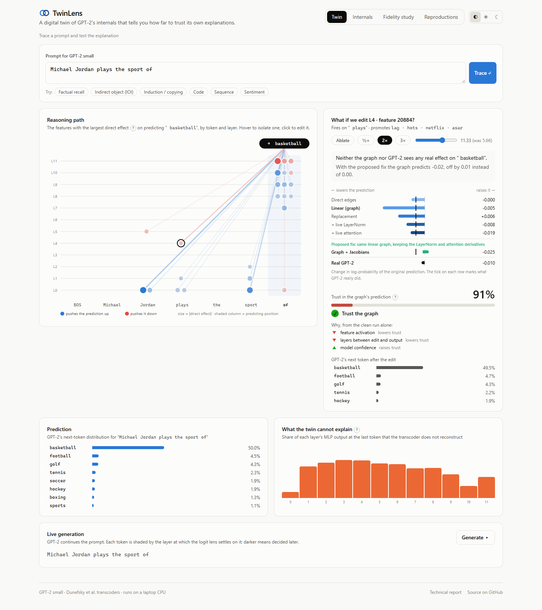
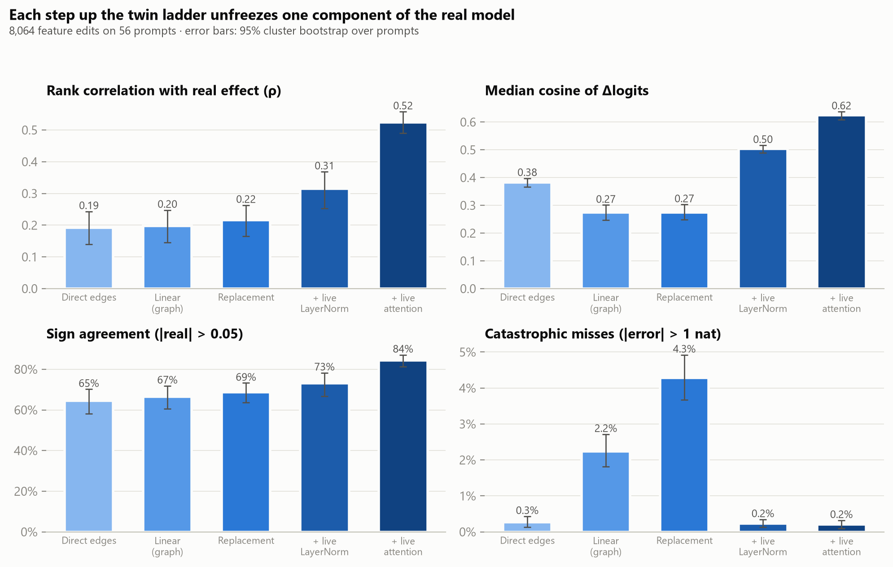
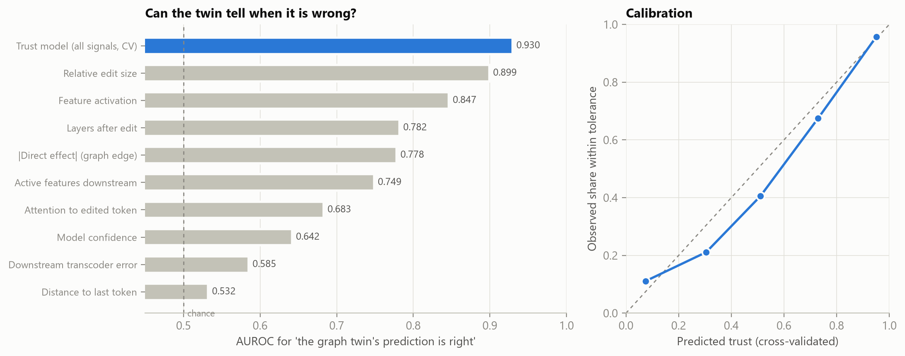
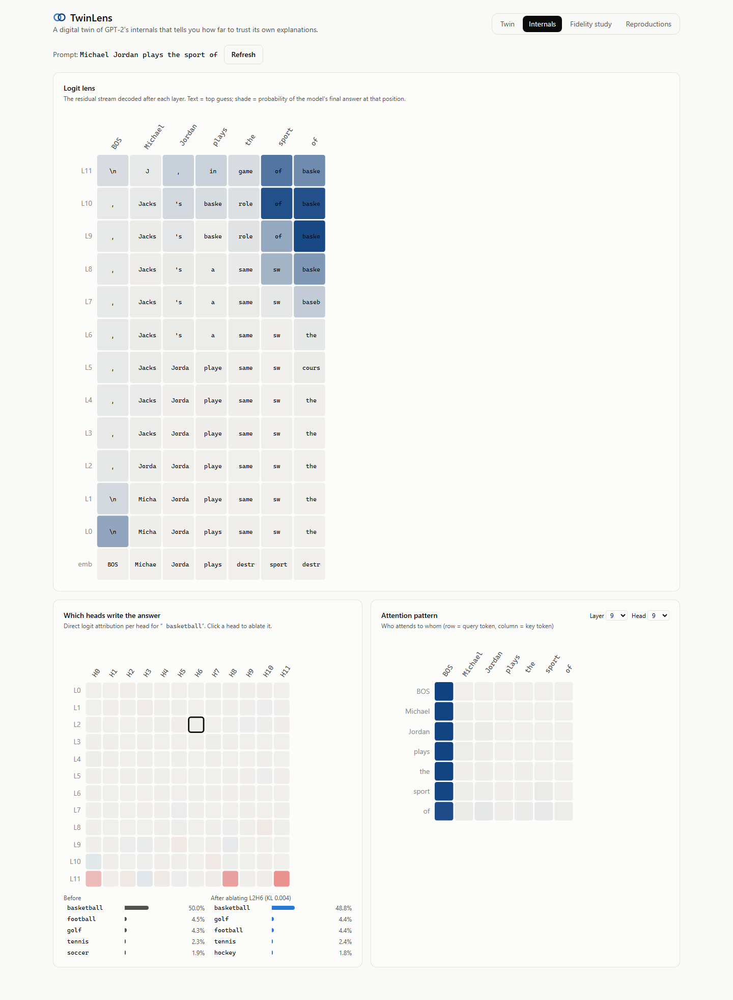
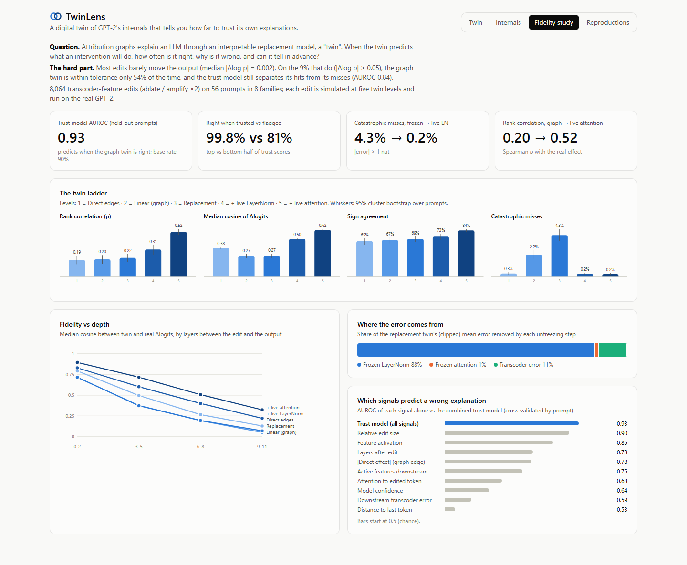

# TwinLens

**A digital twin of GPT-2's internals that tells you how far to trust its own explanations.**

Attribution graphs explain an LLM through an interpretable *replacement model*, a "twin" of the
real network. TwinLens runs that twin side by side with the real GPT-2. Click any feature in the
reasoning graph and three things happen:

1. the twin **predicts** what turning the feature off or up will do, at five levels of
   approximation;
2. the real model **answers**;
3. a trust score, computed *before* the real model runs, tells you whether to believe the graph.



## Headline results
From 8,064 interventions on GPT-2 small; full write-up in [`paper/REPORT.md`](paper/REPORT.md).

| | |
|---|---|
| **The graph twin is a weak counterfactual predictor** | rank correlation with the real effect ρ = **0.20**; within tolerance only **54%** of the time on edits that measurably move the output |
| **Frozen LayerNorm is the main culprit** | **88%** of the replacement twin's error; making LN live cuts catastrophic misses **4.3% → 0.2%** |
| **Live attention fixes ranking** | ρ **0.31 → 0.52**, sign agreement **73% → 84%** |
| **The twin can tell when it is wrong** | trust model AUROC **0.93** on held-out prompts (0.84 on high-effect edits); right **99.8%** of the time in its trusted half vs 81% in the flagged half |

<p>
  
  
</p>

## What's inside

**The measuring instrument is validated first.** A from-scratch, hookable GPT-2 in PyTorch
(logits match Hugging Face to 7e-5) reproduces published circuits, and each one is pinned in the
test suite:
- **Induction heads** (Olsson et al., 2022): 5.1, 5.5, 6.9, 7.2, 7.10, the exact top 5.
- **IOI name movers and negative name movers** (Wang et al., 2022): 9.9, 9.6, 10.0 and 10.7,
  11.10.
- **The early and late sites of factual recall** (Meng et al., 2022).

**The twin ladder.** The same hook machinery runs five twins plus the real model:
1. direct edges;
2. linear attribution graph;
3. local replacement model;
4. \+ live LayerNorm;
5. \+ live attention.

Each step unfreezes one component, so every error is attributed to its source.

**A live dashboard** (React + TypeScript + FastAPI):
- **Twin:** the reasoning-path graph, the what-if ladder with the trust meter, and live token
  streaming that shows the layer at which each token was "decided".
- **Internals:** logit lens, attention patterns, and per-head attribution with click-to-ablate.
- **Fidelity study:** the research results, interactive.
- **Reproductions:** the published circuits, computed live.

| Internals | Fidelity study |
|---|---|
|  |  |

## Quickstart

```bash
python -m venv .venv && .venv/Scripts/activate      # Windows; use bin/activate elsewhere
pip install torch --index-url https://download.pytorch.org/whl/cpu
pip install -e ".[dev]"
cd web && npm ci && cd ..

make serve        # builds the dashboard; open http://localhost:8000
make test         # 33 Python tests (unit, reproduction, twin invariants, API)
make web-test     # type-check + vitest
make e2e          # Playwright end-to-end, incl. dark mode (with `make serve` running)
make analyze      # re-derive every number in the report from the committed sweep data
```

On first use the app downloads GPT-2 small (0.5 GB) and the 12 transcoders (1.8 GB) from the
Hugging Face Hub. Docker: `docker compose up`.

## Engineering notes

- **Runs in < 1 GB of RAM on a laptop CPU.** Importing TransformerLens brought the process to
  1.4 GB before any model was loaded, which left no room on the target machine. So the model is ~250 lines of PyTorch, and weights
  and transcoders are memory-mapped: served from the OS page cache, never copied
  ([`DECISIONS.md`](DECISIONS.md)).
- **Sparse transcoder compute.** Only the active columns are computed (~66 of 24,576 per
  token), so the five twin simulations of one what-if take about 1.6 s together on CPU.
- **Correctness by invariants.** Tests check that:
  - every twin level reproduces the clean run exactly;
  - the linear twin is affine;
  - gradient × activation attribution equals the direct-path simulation;
  - DLA sums to the logit.

| CPU latency (Ryzen 7 5700U, 15 tokens) | |
|---|---|
| forward pass | 194 ms |
| twin trace (12 transcoders) | 1.0 s |
| attribution (all features → logit) | 0.9 s |
| what-if, graph twin / full twin | 0.17 s / 0.45 s |
| peak private memory | 0.82 GB |

## Layout

```
twinlens/core       hookable GPT-2, mmap safetensors
twinlens/causal     interventions, activation patching, causal tracing, DLA, logit lens
twinlens/circuits   datasets + published-circuit measurements
twinlens/twin       transcoders, the twin ladder, attribution
twinlens/fidelity   reliability signals, fidelity engine, trust model
server/             FastAPI (REST + WebSocket streaming)
web/                React + TypeScript dashboard, vitest, Playwright
experiments/        sweep, analysis, figures, committed results
paper/REPORT.md     the technical report
```

## Limitations
One small model (GPT-2 small) and one transcoder family; a 56-prompt corpus. See §5 of the
report.
