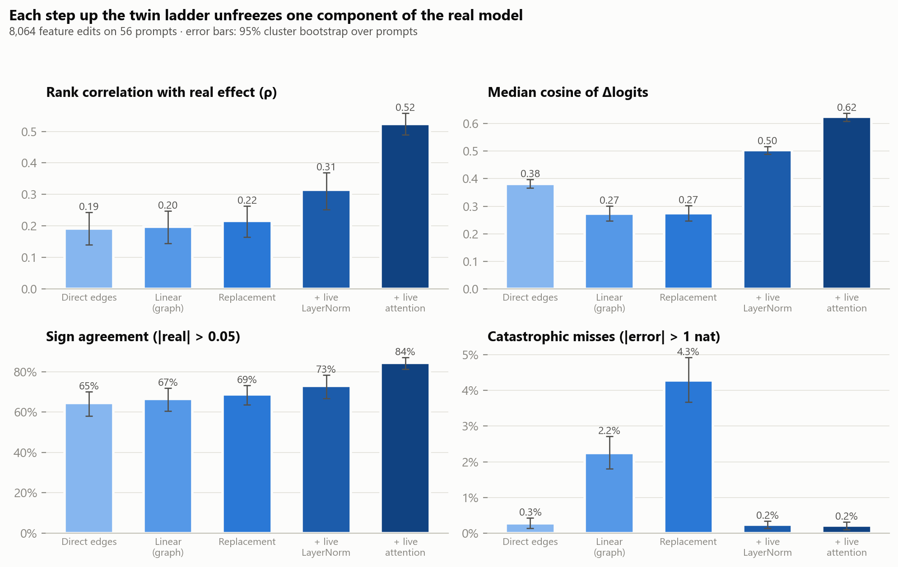
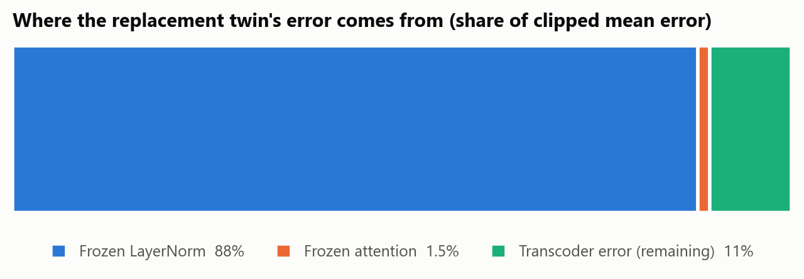
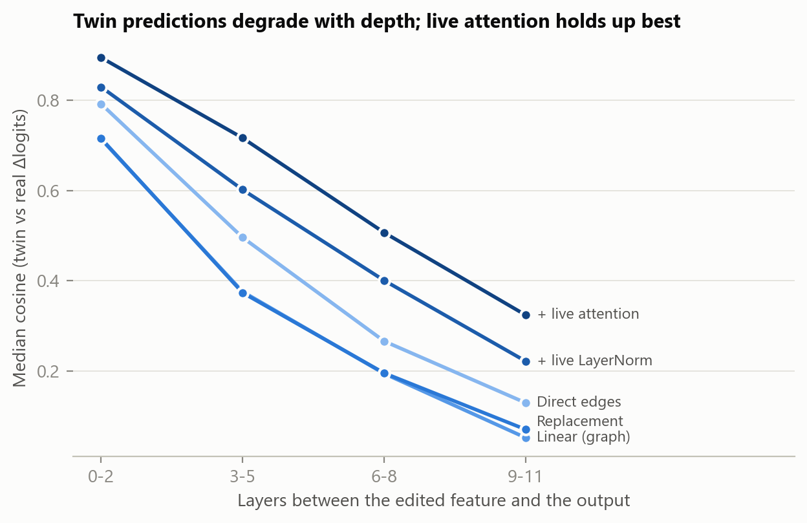
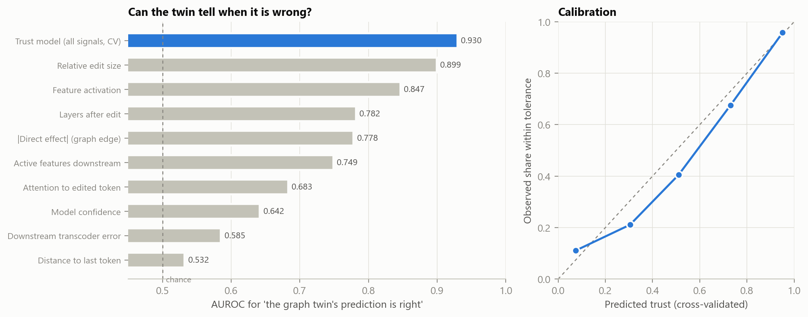
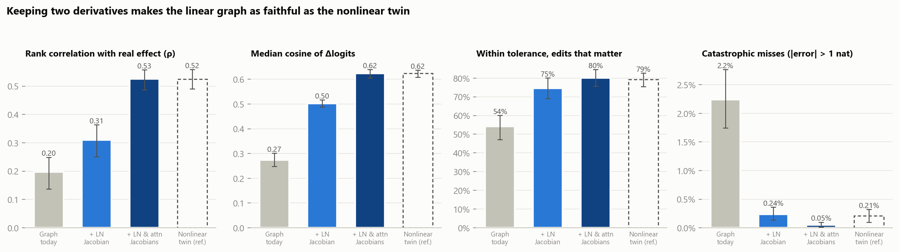
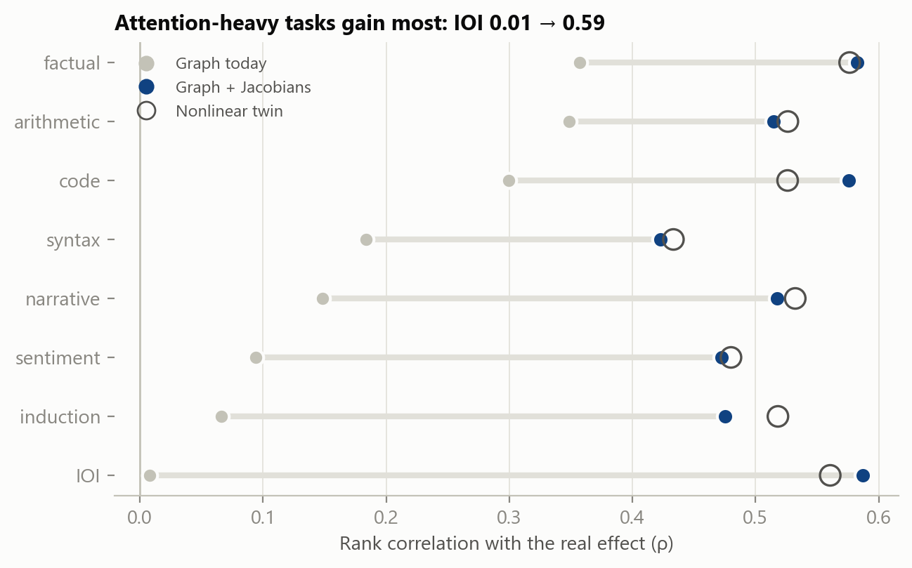
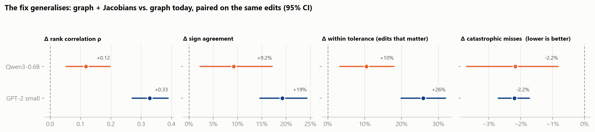

# Attribution graphs fail because of the derivatives they drop, not because they are linear
### Measuring, explaining, predicting and fixing the counterfactual fidelity of transcoder replacement models in GPT-2 small

*Technical report, TwinLens project, October 2026. Code, data and figures: https://github.com/SpiliosDimakopoulos/twinlens*

---

## Abstract

Attribution graphs explain a language model's computation through an interpretable
*replacement model*: MLPs are swapped for sparse transcoders, while attention patterns and
LayerNorm scales are frozen at the clean run. Their edges are read as causal claims: "turn this
feature off and the output moves by this much". We test those claims directly. On GPT-2 small
with per-layer transcoders, we make 8,064 feature interventions (ablate or amplify ×2) across 56
prompts in 8 task families. We predict each intervention's effect with a ladder of twins, each
unfreezing one more component of the real model, and then measure it on the real model.

Five findings:

1. **The linear twin that attribution graphs describe is a weak counterfactual predictor.** Its
   rank correlation with the real effect is ρ = 0.20 [0.14, 0.25]. On edits that measurably move
   the output, it is within tolerance only 54% [47, 60] of the time, which is worse than
   predicting "no change" (75%). It is worst on attention-mediated tasks: ρ ≈ 0.01 on IOI and
   0.07 on induction.
2. **The error comes from two frozen components.** Frozen LayerNorm accounts for 88% of the
   replacement twin's clipped mean error (70–96% depending on the clip) and almost all
   catastrophic misses, which are concentrated in the first three layers. Frozen attention
   accounts for most of the remaining *ranking* error.
3. **The fix keeps the graph linear.** Freezing a scale or a pattern drops its first-order
   derivative. Restoring both terms (the LayerNorm-scale Jacobian and the softmax-pattern
   Jacobian) still gives an exactly linear twin, so effects stay additive over sources. That
   linear twin matches the fully nonlinear replacement model on every metric:
   - ρ 0.20 → **0.53** [0.49, 0.56] (nonlinear twin: 0.52);
   - sign agreement 67% → **86%**;
   - catastrophic misses 2.2% → **0.05%** (4 of 8,064 edits);
   - IOI ρ 0.01 → **0.59**.

   The fix replicates on a second, architecturally different model, Qwen3-0.6B (§4.7): the
   paired improvement in ρ is +0.12 [0.05, 0.20] and catastrophic misses fall from 3.0% to
   0.8%. The gain is smaller than on GPT-2, on 16 prompts, with every paired interval
   excluding zero (uncorrected for multiple metrics).
4. **Failures of today's graph can be anticipated without running the real model.** A logistic
   "trust model" over nine signals computed from the clean run alone predicts whether the
   graph prediction will hold: AUROC 0.93 on held-out prompts and on held-out *task families*
   over all edits, and 0.84 on the edits with a noticeable effect, where the task is not
   trivial (95% interval 0.80–0.87). Simpler signals do about as well or better: the size of
   the graph's own prediction (0.87 on noticeable edits), or its disagreement with the fixed
   graph (0.94). Among the top attribution edges with a noticeable effect, the graph is right 54% of the time overall, 71%
   on the edges the trust model clears, and 22% on those it flags.

5. **The fixed graph beats a gradient through the real model.** Attribution patching, one
   backward pass through GPT-2 itself with nothing frozen, reaches ρ = 0.38 and 77% sign
   agreement on the same edits. Fix B is better on both: Δρ +0.15 [0.11, 0.19] and +9 pp
   [4, 14] in sign agreement, with the same error size (§4.8).

Effects in this study are small: only 9.0% of edits move the output by more than 0.05 nats and
96 edits by more than 0.2 nats. The rank and sign results are the robust ones; the
within-tolerance and mean-error numbers should be read against the "no change" baseline (§3).

The repository includes a dashboard and a command-line audit (`twinlens audit`) that show, for
any feature, the effect predicted at each twin level, the real effect, and the trust score.

---

## 1. Motivation

Mechanistic interpretability increasingly explains model behaviour through replacement models:
sparse autoencoders, transcoders and cross-layer transcoders, assembled into attribution graphs
(Dunefsky et al., 2024; Ameisen et al., 2025; Lindsey et al., 2025). Such a graph is a *digital
twin* of the model's computation on one prompt. Like an industrial digital twin, it is useful
only if its simulations agree with the real system under intervention. Ameisen et al. validate
graphs with perturbation experiments, note that the replacement model's agreement with the
real model degrades with depth after an intervention, and suspect the frozen normalisation
denominators as a cause of magnitude errors; they also state that frozen attention patterns
leave QK circuits out of the graph. For gradient attribution on the real model, Kramár et al.
(2024) show that a saturated attention softmax makes first-order estimates fail. We measure, edit by edit, four things these works leave open for transcoder graphs: when the
graph's predictions fail, how much of the failure each frozen component causes, whether adding
back the missing first-order terms removes it, and whether a failure can be spotted without
running the real model. We are not aware of earlier work that measures them together. The
last question matters in practice. A user reading a graph cannot re-run every edge as an experiment.

## 2. Setup

**Model.** GPT-2 small (124M parameters, 12 layers, 12 heads, d_model = 768). It runs on our own
~250-line PyTorch implementation (`twinlens/core/gpt2.py`), which exposes TransformerLens-style
hook points and reads weights through memory-mapped safetensors. The whole system (model, 12
transcoders, activation caches) fits in 0.82 GB of private memory on a laptop CPU. Logits match
Hugging Face `GPT2LMHeadModel` to 7×10⁻⁵ (max abs).

**Twin features.** We use the per-layer MLP transcoders for GPT-2 small of Dunefsky, Chlenski &
Nanda (2024): 24,576 ReLU features per layer. Each reads `LayerNormPre(resid_mid)` and predicts
`mlp_out`. We verified this convention empirically: at layer 8 it gives L0 ≈ 66 and FVU 0.41,
while the alternatives give FVU > 1. On an 87-token paragraph, splicing a transcoder in place of
its MLP recovers 63–94% of the loss gap to mean-ablating that MLP (layers 2, 5, 8, 11).

**Validating the instrument.** Before making any new measurement, the implementation is checked
against published circuit results. Each check is pinned as a test
(`tests/test_reproduction.py`):

- **Induction heads** (score as defined by Olsson et al., 2022, who do not study GPT-2 small).
  On repeated random tokens, the five highest induction scores are heads 5.1, 5.5, 6.9, 7.2
  and 7.10. These are the heads commonly reported as induction heads in GPT-2 small; we treat
  this as a consistency check, not as a reproduction of a published table.
- **Indirect object identification** (Wang et al., 2022):
  - The top-3 heads by direct logit attribution to IO − S are the name movers 9.9, 9.6 and 10.0.
  - The two most negative heads are the negative name movers 10.7 and 11.10.
  - Activation patching of heads ranks 9.9 first.
  - Mean-ablating the name movers lowers the logit difference from 2.85 to 2.0, while three
    random heads leave it unchanged. The drop is only partial, consistent with the backup name
    movers the paper reports.
- **Causal tracing** (Meng et al., 2022, whose main model is GPT-2 XL; we check only the
  qualitative pattern on GPT-2 small):
  - Restoring the residual stream reproduces the early site (last subject token) and the late
    site (final token).
  - Attention effects concentrate at the final token in layers 8–10.
  - In GPT-2 small the MLP effect at the last subject token peaks in layers 0–1. This is earlier
    than the mid-layer site reported for GPT-2 XL.
- **Completeness.** Per-component direct logit attributions sum to the logit difference
  (within 10⁻³).

## 3. The twin ladder

Fix a prompt and its clean run. A *feature edit* sets transcoder feature *f* at layer *l* and
position *p* from its clean activation *a* to *a′*: 0 to ablate, 2a to amplify. We compare the
change it causes in the log-probability of the clean top-1 token, Δlog p, under five twin levels, two fixes and the real model:

| level | downstream features | LayerNorm scales | attention patterns |
|---|---|---|---|
| 1 Direct edges | held at clean values | frozen | frozen |
| 2 Linear (graph) | ReLU gates frozen (linear) | frozen | frozen |
| 3 Replacement | recomputed (ReLU) | frozen | frozen |
| 4 + live LayerNorm | recomputed | live | frozen |
| 5 + live attention | recomputed | live | live |
| Fix A: graph + LN Jacobian | ReLU gates frozen (linear) | frozen + first-order term | frozen |
| Fix B: graph + LN & attention Jacobians | ReLU gates frozen (linear) | frozen + first-order term | frozen + first-order term |
| Real GPT-2 | real MLPs | live | live |

In every twin level, each MLP is replaced by its transcoder plus that layer's clean-run error
term (`mlp_out − transcoder(mlp_in)`), held fixed. So at zero perturbation every level
reproduces the clean logits exactly; this is tested for every level. In the real model, an edit
moves the feature's decoder direction, `mlp_out[p] += (a′ − a)·W_dec[f]`, and everything
downstream is recomputed.

Level 2 is the attribution graph itself, run as a model: a change at any feature spreads
through the graph's edges and nothing else, so its output is a linear (affine) function of the
edit, which is tested. In the rest of the report "the graph twin", "today's graph" and
"level 2" all mean this level. Level 1 keeps only the edited feature's direct path. Its prediction equals the gradient × activation attribution, and our
tests check this equality to 1%. Because levels 3–5 each unfreeze one component, the gaps
between consecutive levels attribute the twin's error to its sources.

**Edits.** For each prompt and each layer we take two groups of features:
- the 3 active features with the largest |direct effect| on the predicted token ("top": the
  edges a user would inspect first);
- 3 uniformly random active features ("random").

Each feature is both ablated and amplified. BOS is excluded. The 56 prompts span 8 families:
factual recall, IOI, induction/copying, syntax, code, sequences (named `arithmetic` in the
data), narrative and sentiment
(`experiments/prompts.json`). That gives 8,064 edits, each predicted by five twin levels and two fixes and measured on the real model.

**Metrics.**
- Spearman ρ between predicted and real Δlog p.
- Median cosine between the predicted and real change in centred logits.
- Sign agreement, on edits where |real Δlog p| > 0.05.
- Catastrophic misses: |error| > 1 nat.
- *Within tolerance*: |predicted − real| ≤ 0.1 + 0.25·|real|, i.e. off by at most 0.1 nats
  plus a quarter of the real effect.
- *Clipped mean error*: mean |predicted − real|, with each error capped at 5 nats so that a
  few runaway predictions cannot dominate the average.

Intervals are 95% cluster bootstraps over prompts (1,000 resamples). The tables in §4.1 and
§4.5 come from separate bootstrap runs, so the intervals of a shared row can differ in the
second decimal.

**Most edits barely matter.** The median |real Δlog p| is 0.0024, and only 9.0% of edits (729)
move it by more than 0.05. Aggregate tolerance rates are therefore inflated by easy cases. We
also report every headline number on this subset of edits with a noticeable effect, called
"big edits" below. Almost all
of it (718 of 729) comes from the top-attribution group. Even this subset is mostly small
effects: its mean |real Δlog p| is 0.13, 96 edits exceed 0.2 nats and 21 exceed 0.5.

**The "no change" baseline.** Because effects are small, a predictor that always answers
"nothing happens" is a strong reference for the threshold and error metrics. It is within
tolerance on 97.7% of all edits and 74.8% of big edits, with a clipped mean error of 0.018.
It carries no rank or sign information, so ρ and sign agreement are the metrics that
discriminate between twins; the within-tolerance and mean-error columns should be read
against this baseline.

## 4. Results

### 4.1 The ladder



| level | ρ (all) | ρ (big) | median cos | sign agree (big) | within tol (big) | catastrophic |
|---|---|---|---|---|---|---|
| 1 Direct edges | 0.19 [0.14, 0.24] | 0.27 [0.12, 0.39] | 0.38 [0.37, 0.40] | 64.6% [58.1, 70.2] | 73.1% [67.5, 78.3] | 0.3% [0.1, 0.4] |
| 2 Linear (graph) | 0.20 [0.15, 0.25] | 0.24 [0.09, 0.37] | 0.27 [0.25, 0.30] | 66.5% [60.5, 71.9] | 54.2% [47.4, 60.5] | 2.2% [1.8, 2.7] |
| 3 Replacement | 0.22 [0.16, 0.26] | 0.28 [0.16, 0.41] | 0.27 [0.25, 0.30] | 68.7% [63.6, 73.3] | 55.1% [49.1, 60.9] | 4.3% [3.7, 4.9] |
| 4 + live LayerNorm | 0.31 [0.25, 0.37] | 0.41 [0.26, 0.53] | 0.50 [0.49, 0.52] | 73.1% [66.8, 78.3] | 73.7% [67.8, 78.7] | 0.2% [0.1, 0.3] |
| 5 + live attention | 0.52 [0.49, 0.56] | 0.64 [0.56, 0.71] | 0.62 [0.61, 0.64] | 84.4% [81.2, 87.1] | 79.3% [75.7, 82.5] | 0.2% [0.1, 0.3] |

**The graph twin is a weak counterfactual predictor, and it fails in the cases that matter
most.** For the 50% of edits taken from the top attribution edges, catastrophic misses rise to
4.2% at level 2, against 0.3% for random features. The edges a user is most likely to act on
are the ones most likely to be badly wrong. On big edits the graph twin's within-tolerance
rate (54%) is below the "no change" baseline (75%), and its clipped mean error (0.113) is six
times that baseline's (0.018).

**Catastrophic misses are an early-layer phenomenon.** Of the 181 catastrophic misses at
level 2, 137 are edits in layer 0 (20% of all layer-0 edits) and 174 are in layers 0–2; 127
are ablations and 54 amplifications. Excluding layer 0 entirely, the graph twin still has
ρ = 0.23 and 72% sign agreement on big edits, so the weak ranking is not a layer-0 artefact,
but its catastrophic rate falls to 0.6%.

**Reading a single edge beats propagating through the frozen linear twin.** The direct-edge
prediction has higher median cosine (0.38 vs 0.27), a higher within-tolerance rate on big
edits (73% vs 54%), and almost no catastrophic misses (0.3% vs 2.2%). With LayerNorm frozen, a change that travels through later layers is never scaled back down,
so it grows instead. Adding the indirect paths therefore makes the prediction worse.

### 4.2 Where the error comes from



Measured by clipped mean error (errors capped at 5 nats), frozen LayerNorm accounts for **88%**
of the replacement twin's error. Frozen attention accounts for 1.5%, and the transcoders (their
reconstruction error, held fixed) for the remaining 11%. Two caveats. The shares depend on the
clip, because the frozen-scale errors are heavy-tailed: the LayerNorm share is 70% with a
1-nat clip, 79% at 2 nats and 96% at 20 nats. And the decomposition follows one unfreezing
order (LayerNorm, then attention); we did not run the reverse order, so the split between the
two is not unique.

Single cases show the mechanism. An edited layer-0 feature whose decoder
contribution is 50–90% of the residual-stream norm pushes the frozen-scale twin far outside the
transcoders' training distribution. Downstream features then grow layer after layer, and in
extreme cases the predicted change in log-probability exceeds 10⁷ nats. The real model, with
live LayerNorm, renormalises the perturbation away.

Frozen attention adds little to the *mean* error but a lot to the *ranking* error: its errors
are many and moderate rather than few and huge. Making attention live lifts ρ from 0.31 to
0.52 and sign agreement from 73% to 84%. The per-family breakdown agrees. At level 2, ρ is 0.01 on IOI
and 0.07 on induction (both attention-mediated circuits) but 0.36 on factual recall. At level 5
all families sit between 0.43 and 0.58.

### 4.3 Fidelity decays with depth



The median cosine between predicted and real Δlogits falls with the number of layers between
the edit and the output, at every level. The decline matches the per-layer compounding Ameisen
et al. describe. For the graph twin it goes from 0.71 (0–2 layers) to 0.05 (9–11 layers). For
the live-attention twin it goes from 0.89 to 0.32.

### 4.4 Predicting when the twin is wrong



The trust model predicts *within tolerance* for the graph twin from nine signals of the clean
run, with no access to the real model's response. Under 5-fold cross-validation grouped by
prompt:

- **AUROC 0.93** over all edits (base rate 90%). Most of this is the easy distinction between
  negligible edits, which are within tolerance almost by definition, and the rest.
- AUROC 0.84 on big edits, where the base rate is only 54%; this is the more informative number.
  A cluster bootstrap over prompts (CV scores held fixed) gives 0.80–0.87 for big edits and
  0.92–0.94 over all edits.
- **Simpler baselines.** The absolute size of the graph's own prediction, which is also
  available before the real model runs, reaches AUROC 0.99 over all edits and 0.87 on big
  edits with no fitting: about the same as the trust model, within its interval. The
  disagreement between today's graph and Fix B (§4.5) reaches 0.99 and 0.94, clearly better.
  The nine-signal model is therefore not needed to flag failures; a prediction the fixed
  graph contradicts is the better warning.
- The best single signal, relative edit size (‖Δa·W_dec‖ / ‖resid‖), reaches 0.90. Activation
  reaches 0.85, layers to output 0.78, and |direct effect| 0.78.
- **Trusted vs flagged.** Ranking edits by predicted trust, the top half is within tolerance
  99.8% of the time and the bottom half 80.6%.
- **Calibration.** Calibration is reasonable at the top, where most edits sit: predicted 0.95 vs
  observed 0.96. It is slightly over-confident between 0.3 and 0.7.

The standardised coefficients are interpretable. Trust falls with edit size (−0.53),
activation (−0.66), the number of layers to the output (−0.53), the number of active downstream
features (−0.33), and attention from the output position to the edited token (−0.30). It rises
with model confidence (+0.56).

### 4.5 The fix: keep the derivatives, keep the linearity



**LayerNorm.** LayerNorm divides the centred residual stream u by its scale σ(u). Today's
graph keeps σ at its clean value σ₀, so a change du passes through as da = du/σ₀. But σ itself
changes when u changes. Taking that into account to first order gives

    dn = da − n₀ (n₀ · da) / d,

where n₀ is the clean normalised output and d = 768 is the width of the residual stream. The
second term removes the part of the change that only rescales the vector, which LayerNorm
would undo. Today's graph keeps only `da`.

**Attention.** Today's graph keeps each attention pattern p at its clean value p₀. But a change
in the queries and keys (dq, dk) changes the scores by ds = (dq · k₀ + q₀ · dk) / √d_head, and
the softmax turns that into

    dp = p₀ ⊙ (ds − Σₖ p₀ ds).

The head output z = p·v then becomes z = p₀v₀ + p₀·dv + dp·v₀. We drop the product of the two
changes (dp·dv), which is second-order.

Adding both terms keeps the model linear: Fix B is affine in the perturbation (tested), and it
is the exact first-order expansion of the twin with frozen ReLU gates but live LayerNorm and
attention. On a 1% edit it agrees with that twin to within 5%, while the frozen versions do not
(`tests/test_twin.py`). In practice it is the attribution graph obtained by not detaching the
LayerNorm scales and attention scores during backpropagation.

| twin | ρ (all) | ρ (big) | median cos | sign agree (big) | within tol (big) | catastrophic | mean err |
|---|---|---|---|---|---|---|---|
| Graph today (frozen LN + attention) | 0.20 [0.14, 0.25] | 0.24 [0.07, 0.36] | 0.27 [0.25, 0.30] | 66.5% [59.6, 71.7] | 54.2% [47.1, 60.1] | 2.2% [1.7, 2.8] | 0.113 |
| Fix A: + LN Jacobian | 0.31 [0.25, 0.36] | 0.41 [0.28, 0.53] | 0.50 [0.49, 0.52] | 73.0% [67.4, 78.2] | 74.6% [69.0, 80.1] | 0.2% [0.1, 0.4] | 0.024 |
| **Fix B: + LN & attention Jacobians** | **0.53 [0.49, 0.56]** | **0.66 [0.59, 0.72]** | **0.62 [0.61, 0.64]** | **85.7% [82.1, 88.8]** | **80.1% [75.6, 84.6]** | **0.0% [0.0, 0.1]** | **0.019** |
| Nonlinear twin (live LN + attention) | 0.52 [0.49, 0.56] | 0.64 [0.56, 0.71] | 0.62 [0.61, 0.64] | 84.4% [81.6, 87.1] | 79.3% [75.5, 82.8] | 0.2% [0.1, 0.3] | 0.022 |

- Fix A matches level 4 (live LayerNorm) within the intervals on every metric while staying
  linear. It cuts mean error by 79%, and catastrophic misses among the top
  edges from 4.2% to 0.47%.
- Fix B matches the nonlinear twin within the intervals on every metric. Top-edge catastrophic misses
  fall to 0.10%. Since Fix B is linear and the nonlinear twin is not, the remaining gap to the
  real model is due to the transcoders, not to linearisation.
- Against the "no change" baseline the gain is in rank and sign, not in error size. Fix B
  is within tolerance on 80% of big edits against 75% for "no change", and its clipped mean
  error (0.019) equals that baseline's (0.018). What it adds is the direction and ordering of
  effects: ρ 0.53 and 86% sign agreement, where "no change" has neither.
- **The gain does not depend on layer 0.** Excluding layer-0 edits, ρ goes from 0.23 to 0.56
  and sign agreement on big edits from 72% to 91%.



The gains are largest exactly where today's graphs fail: IOI ρ goes from 0.01 to 0.59 and
induction from 0.07 to 0.48. These are the attention-mediated circuits, where freezing attention
patterns removes the mechanism itself.

### 4.6 Does the trust model transfer, and what does it buy?

- **Transfer.** Leaving out one task family at a time (training on 7, testing on the 8th), the
  trust model's AUROC is 0.93 on average over all edits, ranging from 0.88 (sentiment) to 0.98
  (sequences). On big edits only, the held-out-family AUROC averages 0.84, from 0.72 (IOI) and
  0.77 (induction) to 0.92 (sequences). It is not memorising task types, but it transfers
  worst to the attention-mediated families.
- **Payoff.** Consider the edges a user would actually inspect: the top attribution edges, on
  edits with a noticeable effect (n = 718).
  - Today's graph is within tolerance on 54% of them.
  - Keeping only the edges the trust model clears (66% of them) raises that to 71%.
  - The flagged third is right only 22% of the time.

  The 0.7 cut-off was fixed by hand, not tuned on held-out data; at 0.5 the kept edges are
  right 68% of the time and at 0.9, 91% (keeping 31%). Keeping instead the same share of edges
  with the *smallest* graph prediction gives 77%, so the simple baseline of §4.4 is at least
  as good a filter. Either way, failures can be screened without running an extra
  intervention, but a cleared edge is still wrong about a quarter of the time.

### 4.7 Does the fix generalise? Qwen3-0.6B

We replicated Fix B (graph + LayerNorm and attention Jacobians, level `linear_fulljac`) on a
second, architecturally different model: Qwen3-0.6B, which uses RMSNorm instead of LayerNorm,
grouped-query attention, RoPE, QK-norm and SwiGLU. We used its public `circuit-tracer`
transcoders (163,840 features per layer, `mwhanna/qwen3-0.6b-transcoders-lowl0`). The scope is
smaller than for GPT-2: 2,304 feature edits on 16 prompts (2 per task family), with edits in
layers 10-27 of 28 (the upper two thirds). Qwen3 has no BOS token, and its first token is an
attention sink on which transcoders fire thousands of features; we leave that position to the
error term, so the first word of a prompt is never edited. The levels compared are direct edges, graph today
(linear), Fix A (adding the normalisation Jacobian, here RMSNorm including QK-norm), Fix B, and
the real model. The nonlinear replacement twins were not run on Qwen3, because a full
164k-feature encode per simulation is too slow on CPU.

The Jacobians are verified by tests on Qwen3 as well (`tests/test_qwen.py`, not run in CI
because they need ~7 GB of transcoders): the levels used here reproduce the clean run under a
no-op edit, the linear levels are exactly affine, and Fix B agrees with the
live-norm/live-attention twin to within 5% on a 1% edit.

| Level | ρ [95% CI] | sign agree | within tol (big) | catastrophic | mean err |
|---|---|---|---|---|---|
| Graph today | 0.33 [0.23, 0.43] | 78.5% | 51.5% | 3.0% | 0.138 |
| Fix A | 0.42 [0.33, 0.50] | 85.6% | 58.6% | 1.4% | 0.083 |
| Fix B | 0.45 [0.36, 0.53] | 87.7% | 62.0% | 0.8% | 0.070 |

On induction prompts ρ rises from 0.04 to 0.28.



Paired improvement of Fix B over graph today (same edits, 95% cluster bootstrap over prompts):

- **GPT-2 small:** Δρ +0.33 [0.27, 0.39]; Δ sign agreement +19 pp [15, 24]; Δ within tolerance
  (big) +26 pp [20, 32]; Δ catastrophic -2.2 pp [-2.7, -1.7].
- **Qwen3-0.6B:** Δρ +0.12 [0.05, 0.20]; Δ sign agreement +9 pp [2, 17]; Δ within tolerance
  (big) +10 pp [3, 18]; Δ catastrophic -2.2 pp [-3.7, -0.8].

All intervals exclude zero, with no correction for the four metrics and only 16 prompt
clusters on Qwen3. The gain points the same way on every metric, but it is smaller than on
GPT-2. One possible reason is that this transcoder family has a larger reconstruction error,
which no Jacobian can repair; we have not tested this.

Fix B also does less against the "no change" baseline here. On big edits (n = 326) it is
within tolerance 62% of the time, against 59% for "no change", and its clipped mean error
(0.070) is twice that baseline's (0.035). On Qwen3 the fix improves the ranking and the sign of
predicted effects, but their size is still often wrong. We also cannot say whether the linear
fix matches the nonlinear twin on Qwen3, because that twin was not run. The gain is also
not uniform across task families: it is largest on induction, syntax, sentiment and IOI, and
roughly flat on code and narrative.

### 4.8 Is Fix B more than a backward pass? Attribution patching on the real model

Attribution patching estimates an edit's effect with one gradient through the real model:
Δlog p ≈ ∂log p/∂mlp_out[l, p] · (a′ − a) W_dec[f] (Syed et al., 2024; Kramár et al., 2024).
LayerNorm and attention are differentiated, not frozen, and the MLPs are the real ones, so it
has every derivative Fix B restores and more. We computed it for all 8,064 edits
(`experiments/atp_baseline.py`, `experiments/analyze_atp.py`):

| predictor | ρ [95% CI] | sign agree (big) | within tol (big) | catastrophic | mean err |
|---|---|---|---|---|---|
| Graph today | 0.20 [0.14, 0.25] | 66.5% | 54.2% | 2.2% | 0.113 |
| Attribution patching (real GPT-2) | 0.38 [0.34, 0.42] | 76.5% | 77.0% | 0.1% | 0.019 |
| Fix B | 0.53 [0.49, 0.56] | 85.7% | 80.1% | 0.0% | 0.019 |

Paired on the same edits, Fix B − attribution patching is Δρ +0.15 [0.11, 0.19] and +9 pp
[4, 14] in sign agreement; within tolerance (+3 pp [−2, 8]), catastrophic misses and mean error
are indistinguishable. A gradient through the real model avoids the frozen graph's large
errors, but it ranks and signs effects worse than the linear twin with the two Jacobians. One
reading is that the twin's first-order expansion is taken through sparse transcoder features
with fixed ReLU gates, which behave more linearly under a feature-sized edit than the real
GELU MLPs do; we have not tested this explanation.

## 5. Limitations

- **Two models, two transcoder families.** GPT-2 small with per-layer transcoders, and
  Qwen3-0.6B with `circuit-tracer` transcoders, where we covered only the upper 18 layers and
  far fewer edits (§4.7). Larger models and cross-layer transcoders, which the current
  circuit-tracing work uses, remain untested.
- **One gradient baseline.** §4.8 compares Fix B with attribution patching on GPT-2 only.
  Integrated-gradient variants (Marks et al., 2024; Hanna et al., 2024) and AtP* (Kramár et
  al., 2024) were not run, and the comparison was not repeated on Qwen3.
- **Only feature-to-output effects are tested.** A graph also asserts feature-to-feature
  edges; we never measure an intermediate feature's response to an edit.
- **Effects are small and early layers dominate the failures.** See §3 and §4.1: few edits
  move the output by more than 0.2 nats, and three quarters of the catastrophic misses are
  layer-0 edits. Results for large, behaviour-changing interventions are not established.
- **Top features are selected by the quantity being evaluated.** The "top" group is chosen by
  |direct effect|, the level-1 prediction, so its predictions are biased towards
  overestimation by selection.
- **The intervention is defined in the twin's basis.** In the real model we move the feature's
  decoder direction rather than "the concept". This is the natural ground truth for the claim
  "this edge matters", but it is not the only possible one.
- **The tolerance threshold is a choice** (0.1 nats + 25%). The ladder's ordering is the same
  under rank correlation and cosine, which use no threshold.
- **Small prompt set** (56 prompts, written by us), and only one prediction target per prompt
  (the top-1 token). The bootstrap is over prompts, so the intervals reflect this.
- **Graphs built on Fix B are denser.** Edges then also flow through attention *scores* (QK
  paths), not only OV paths. Effects remain additive and exact for the linear twin, but we
  have not measured how much this increases graph size after pruning.
- **The trust model is fitted to this distribution of edits** (top and random features, ablate
  and ×2). Its transfer to other edit types, such as steering with large coefficients, is untested.

## 6. Related work

- **Circuits and their validation.** Elhage et al. (2021) give the framework. Olsson et al.
  (2022) and Wang et al. (2022) describe the circuits we reproduce. Meng et al. (2022)
  introduced causal tracing. On activation-patching practice: Zhang & Nanda (2024); Heimersheim
  & Nanda (2024).
- **Sparse replacement models.**
  - Sparse autoencoders: Bricken et al. (2023); Cunningham et al. (2023).
  - Sparse feature circuits: Marks et al. (2024).
  - Transcoders: Dunefsky, Chlenski & Nanda (2024).
  - Attribution graphs with cross-layer transcoders (Ameisen et al., 2025; Lindsey et al.,
    2025), and the open-source `circuit-tracer` library.
  - Attention in attribution graphs: Kamath et al. (2025) attribute attention *scores* to
    query and key features while keeping the pattern frozen; Fix B instead differentiates
    through the pattern.
- **Gradient attribution on the real model.** Attribution patching and its refinements (Syed
  et al., 2024; Kramár et al., 2024; Hanna et al., 2024) and the integrated-gradient effects
  of Marks et al. (2024) take gradients through the real model, where LayerNorm and attention
  are differentiated unless explicitly detached (we have not checked each method's exact
  treatment). Kramár et al. identify softmax saturation as a failure mode of first-order
  estimates through attention. Keeping these derivatives is therefore not new outside
  replacement-model graphs; our point is that the graph setting can have them too without
  losing linearity, and that on these edits the resulting linear graph predicts effects better
  than attribution patching does (§4.8).
- **Faithfulness of replacement models.** Ameisen et al. report that perturbation agreement
  decays with depth and suspect the frozen normalisation denominators. Our contributions:
  - decomposing that error into frozen-LN, frozen-attention and transcoder components, on a
    large sampled set of interventions;
  - showing that restoring the two dropped first-order terms removes it without giving up
    linearity;
  - showing that the remaining failures can be anticipated from the clean run.

## 7. Reproducing

```
make test           # 33 tests, including the reproduction suite
make sweep          # 8,064 edits, ~40 min on a laptop CPU (resumable)
python experiments/extend_sweep.py --modes linear_lnjac     # Fix A, ~10 min
python experiments/extend_sweep.py --modes linear_fulljac   # Fix B, ~15 min
python experiments/qwen_prepare.py                                   # Qwen3 transcoders, ~6 GB, ~70 min
python experiments/fidelity_sweep.py --model qwen3 --per-family 2 --n-top 2 --n-random 2   # 2,304 edits, ~30 min
make analyze        # analyze.py + analyze_generalization.py: summary.json, trust_model.json, figures
make serve          # dashboard at http://localhost:8000
```

The sweep's raw output (`experiments/results/fidelity.parquet`, 1.3 MB) is committed, so
`make analyze` reproduces every number above without re-running the sweep (the robustness
checks of §3–§4.7 are in the `robustness` and `generalization` blocks of `summary.json`). The
latency figures in the README come from `make bench`.

## References

- Ameisen, E., Lindsey, J., et al. (2025). *Circuit Tracing: Revealing Computational Graphs in
  Language Models.* Transformer Circuits Thread.
- Bricken, T., et al. (2023). *Towards Monosemanticity: Decomposing Language Models With
  Dictionary Learning.* Transformer Circuits Thread.
- Cunningham, H., Ewart, A., Riggs, L., Huben, R., & Sharkey, L. (2023). *Sparse Autoencoders
  Find Highly Interpretable Features in Language Models.* arXiv:2309.08600.
- Dunefsky, J., Chlenski, P., & Nanda, N. (2024). *Transcoders Find Interpretable LLM Feature
  Circuits.* NeurIPS 2024.
- Elhage, N., et al. (2021). *A Mathematical Framework for Transformer Circuits.* Transformer
  Circuits Thread.
- Heimersheim, S., & Nanda, N. (2024). *How to use and interpret activation patching.*
  arXiv:2404.15255.
- Hanna, M., Pezzelle, S., & Belinkov, Y. (2024). *Have Faith in Faithfulness: Going Beyond
  Circuit Overlap When Finding Model Mechanisms.* COLM 2024. arXiv:2403.17806.
- Kamath, H., Ameisen, E., et al. (2025). *Tracing Attention Computation Through Feature
  Interactions.* Transformer Circuits Thread.
- Kramár, J., Lieberum, T., Shah, R., & Nanda, N. (2024). *AtP\*: An efficient and scalable
  method for localizing LLM behaviour to components.* arXiv:2403.00745.
- Lindsey, J., et al. (2025). *On the Biology of a Large Language Model.* Transformer Circuits
  Thread.
- Marks, S., Rager, C., Michaud, E. J., Belinkov, Y., Bau, D., & Mueller, A. (2024). *Sparse
  Feature Circuits: Discovering and Editing Interpretable Causal Graphs in Language Models.*
  ICLR 2025. arXiv:2403.19647.
- Meng, K., Bau, D., Andonian, A., & Belinkov, Y. (2022). *Locating and Editing Factual
  Associations in GPT.* NeurIPS 2022.
- Olsson, C., et al. (2022). *In-context Learning and Induction Heads.* Transformer Circuits
  Thread.
- Syed, A., Rager, C., & Conmy, A. (2024). *Attribution Patching Outperforms Automated Circuit
  Discovery.* BlackboxNLP 2024.
- Wang, K., Variengien, A., Conmy, A., Shlegeris, B., & Steinhardt, J. (2022). *Interpretability
  in the Wild: a Circuit for Indirect Object Identification in GPT-2 small.* arXiv:2211.00593.
- Zhang, F., & Nanda, N. (2024). *Towards Best Practices of Activation Patching in Language
  Models.* ICLR 2024.
