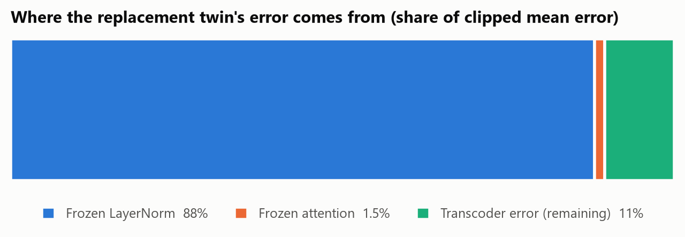
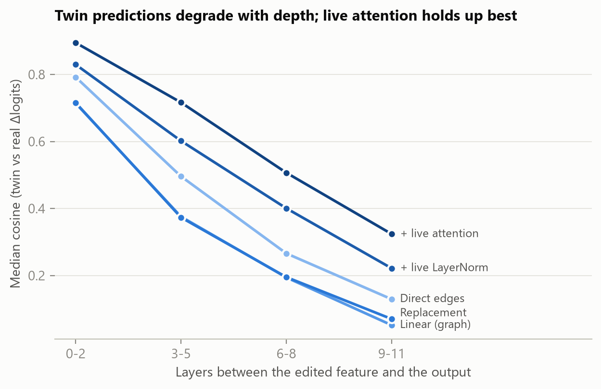
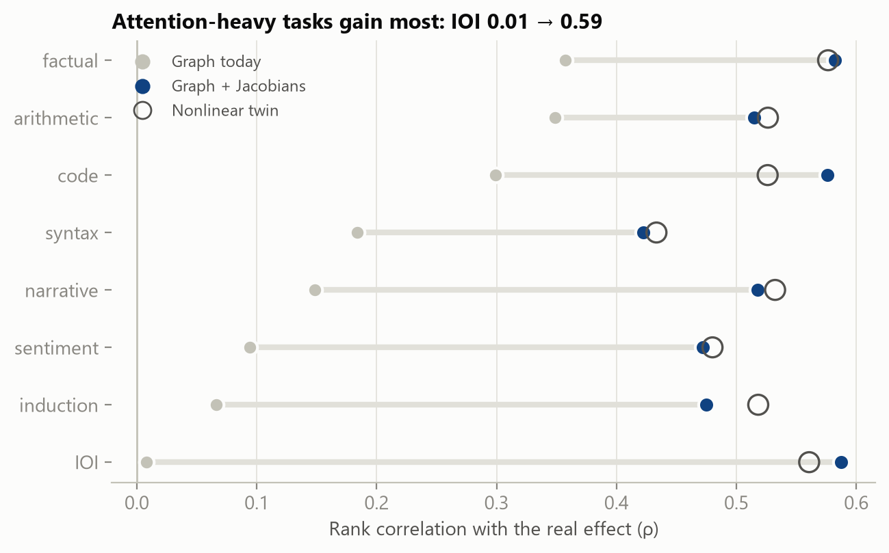

# Attribution graphs fail because of the derivatives they drop, not because they are linear
### Measuring, explaining, predicting and fixing the counterfactual fidelity of transcoder replacement models in GPT-2 small

*Technical report, TwinLens project, October 2026. Code, data and figures: https://github.com/SpiliosDimakopoulos/twinlens*

---

## Abstract

Attribution graphs explain a language model's computation through an interpretable
*replacement model*: MLPs are swapped for sparse transcoders, while attention patterns and
LayerNorm scales are frozen at the clean run. Their edges are read as causal claims: "turn this
feature off and the output moves by this much". We test those claims directly. On GPT-2 small
with per-layer transcoders, we make 8,064 feature interventions (ablate or amplify ×2) across 56
prompts in 8 task families. We predict each intervention's effect with a ladder of twins, each
unfreezing one more component of the real model, and then measure it on the real model.

Four findings:

1. **The linear twin that attribution graphs describe is a weak counterfactual predictor.** Its
   rank correlation with the real effect is ρ = 0.20 [0.14, 0.25]. On edits that measurably move
   the output, it is within tolerance only 54% [47, 60] of the time. It is worst on
   attention-mediated tasks: ρ ≈ 0.01 on IOI and 0.07 on induction.
2. **The error comes from two frozen components.** Frozen LayerNorm accounts for 88% of the
   replacement twin's mean error and almost all catastrophic misses. Frozen attention accounts
   for most of the remaining *ranking* error.
3. **The fix keeps the graph linear.** Freezing a scale or a pattern drops its first-order
   derivative. Restoring both terms (the LayerNorm-scale Jacobian and the softmax-pattern
   Jacobian) still gives an exactly linear twin, so effects stay additive over sources. That
   linear twin matches the fully nonlinear replacement model on every metric:
   - ρ 0.20 → **0.53** [0.49, 0.56] (nonlinear twin: 0.52);
   - sign agreement 67% → **86%**;
   - catastrophic misses 2.2% → **0.05%** (4 of 8,064 edits);
   - IOI ρ 0.01 → **0.59**.

   The attribution graph's problem is therefore not linearity but the derivatives it drops.
4. **The twin can tell in advance when to trust it.** A logistic "trust model" over nine
   signals computed from the clean run alone predicts whether today's graph prediction will
   hold. On held-out prompts its AUROC is 0.93. On held-out *task families* it is 0.93 as well
   (0.88–0.98). Among the top attribution edges with a noticeable effect, the graph is right
   54% of the time overall, 71% on the edges the trust model clears, and 22% on those it flags.

We ship this as a live tool. For any feature you click, TwinLens shows the effect predicted by
every twin level, the real effect, and a trust score computed before the real model runs.

---

## 1. Motivation

Mechanistic interpretability increasingly explains model behaviour through replacement models:
sparse autoencoders, transcoders and cross-layer transcoders, assembled into attribution graphs
(Dunefsky et al., 2024; Ameisen et al., 2025; Lindsey et al., 2025). Such a graph is a *digital
twin* of the model's computation on one prompt. Like an industrial digital twin, it is useful
only if its simulations agree with the real system under intervention. Ameisen et al. validate
graphs with perturbation experiments, and note that the replacement model's agreement with the
real model degrades with depth after an intervention. To our knowledge there is no
systematic, per-intervention account of *when* the twin's counterfactual predictions fail,
*which* frozen component causes the failure, and *whether* failure can be anticipated without
running the real model. That third question matters in practice. A user reading a graph cannot
re-run every edge as an experiment.

## 2. Setup

**Model.** GPT-2 small (124M parameters, 12 layers, 12 heads, d_model = 768). It runs on our own
~250-line PyTorch implementation (`twinlens/core/gpt2.py`), which exposes TransformerLens-style
hook points and reads weights through memory-mapped safetensors. The whole system (model, 12
transcoders, activation caches) fits in 0.82 GB of private memory on a laptop CPU. Logits match
Hugging Face `GPT2LMHeadModel` to 7×10⁻⁵ (max abs).

**Twin features.** We use the per-layer MLP transcoders for GPT-2 small of Dunefsky, Chlenski &
Nanda (2024): 24,576 ReLU features per layer. Each reads `LayerNormPre(resid_mid)` and predicts
`mlp_out`. We verified this convention empirically: at layer 8 it gives L0 ≈ 66 and FVU 0.41,
while the alternatives give FVU > 1. On an 87-token paragraph, splicing a transcoder in place of
its MLP recovers 63–94% of the loss gap to mean-ablating that MLP (layers 2, 5, 8, 11).

**Validating the instrument.** Before making any new measurement, the implementation reproduces
published GPT-2 small results. Each one is pinned as a test (`tests/test_reproduction.py`):

- **Induction heads** (Olsson et al., 2022). On repeated random tokens, the five highest
  induction scores are exactly heads 5.1, 5.5, 6.9, 7.2 and 7.10.
- **Indirect object identification** (Wang et al., 2022):
  - The top-3 heads by direct logit attribution to IO − S are the name movers 9.9, 9.6 and 10.0.
  - The two most negative heads are the negative name movers 10.7 and 11.10.
  - Activation patching of heads ranks 9.9 first.
  - Mean-ablating the name movers lowers the logit difference from 2.85 to 2.0, while three
    random heads leave it unchanged. The drop is only partial, consistent with the backup name
    movers the paper reports.
- **Causal tracing** (Meng et al., 2022):
  - Restoring the residual stream reproduces the early site (last subject token) and the late
    site (final token).
  - Attention effects concentrate at the final token in layers 8–10.
  - In GPT-2 small the MLP effect at the last subject token peaks in layers 0–1. This is earlier
    than the mid-layer site reported for GPT-2 XL.
- **Completeness.** Per-component direct logit attributions sum to the logit difference
  (within 10⁻³).

## 3. The twin ladder

Fix a prompt and its clean run. A *feature edit* sets transcoder feature *f* at layer *l* and
position *p* from its clean activation *a* to *a′*: 0 to ablate, 2a to amplify. We compare the
change it causes in the log-probability of the clean top-1 token, Δlog p, under six models:

| level | downstream features | LayerNorm scales | attention patterns |
|---|---|---|---|
| 1 Direct edges | held at clean values | frozen | frozen |
| 2 Linear (graph) | ReLU gates frozen (linear) | frozen | frozen |
| 3 Replacement | recomputed (ReLU) | frozen | frozen |
| 4 + live LayerNorm | recomputed | live | frozen |
| 5 + live attention | recomputed | live | live |
| Fix A: graph + LN Jacobian | ReLU gates frozen (linear) | frozen + first-order term | frozen |
| Fix B: graph + LN & attention Jacobians | ReLU gates frozen (linear) | frozen + first-order term | frozen + first-order term |
| Real GPT-2 | real MLPs | live | live |

In every twin level, each MLP is replaced by its transcoder plus that layer's clean-run error
term (`mlp_out − transcoder(mlp_in)`), held fixed. So at zero perturbation every level
reproduces the clean logits exactly; this is tested for all six. In the real model, an edit
moves the feature's decoder direction, `mlp_out[p] += (a′ − a)·W_dec[f]`, and everything
downstream is recomputed.

Level 2 is affine in the perturbation, which is tested. It is exactly the object an attribution
graph linearises: graph edges are its partial derivatives. Level 1 keeps only the edited
feature's direct path. Its prediction equals the gradient × activation attribution, and our
tests check this equality to 1%. Because levels 3–5 each unfreeze one component, the gaps
between consecutive levels attribute the twin's error to its sources.

**Edits.** For each prompt and each layer we take two groups of features:
- the 3 active features with the largest |direct effect| on the predicted token ("top": the
  edges a user would inspect first);
- 3 uniformly random active features ("random").

Each feature is both ablated and amplified. BOS is excluded. The 56 prompts span 8 families:
factual recall, IOI, induction/copying, syntax, code, sequences, narrative and sentiment
(`experiments/prompts.json`). That gives 8,064 edits × 6 models.

**Metrics.**
- Spearman ρ between predicted and real Δlog p.
- Median cosine between the predicted and real change in centred logits.
- Sign agreement, on edits where |real Δlog p| > 0.05.
- Catastrophic misses: |error| > 1 nat.
- *Within tolerance*: |predicted − real| ≤ 0.1 + 0.25·|real|.

Intervals are 95% cluster bootstraps over prompts (1,000 resamples).

**Most edits barely matter.** The median |real Δlog p| is 0.0024, and only 9.0% of edits move it
by more than 0.05. Aggregate tolerance rates are therefore inflated by easy cases. We also report
every headline number on this "noticeable effect" subset ("big" below).

## 4. Results

### 4.1 The ladder


| level | ρ (all) | ρ (big) | median cos | sign agree (big) | within tol (big) | catastrophic |
|---|---|---|---|---|---|---|
| 1 Direct edges | 0.19 [0.14, 0.24] | 0.27 [0.12, 0.39] | 0.38 [0.37, 0.40] | 64.6% [58.1, 70.2] | 73.1% [67.5, 78.3] | 0.3% [0.1, 0.4] |
| 2 Linear (graph) | 0.20 [0.15, 0.25] | 0.24 [0.09, 0.37] | 0.27 [0.25, 0.30] | 66.5% [60.5, 71.9] | 54.2% [47.4, 60.5] | 2.2% [1.8, 2.7] |
| 3 Replacement | 0.22 [0.16, 0.26] | 0.28 [0.16, 0.41] | 0.27 [0.25, 0.30] | 68.7% [63.6, 73.3] | 55.1% [49.1, 60.9] | 4.3% [3.7, 4.9] |
| 4 + live LayerNorm | 0.31 [0.25, 0.37] | 0.41 [0.26, 0.53] | 0.50 [0.49, 0.52] | 73.1% [66.8, 78.3] | 73.7% [67.8, 78.7] | 0.2% [0.1, 0.3] |
| 5 + live attention | 0.52 [0.49, 0.56] | 0.64 [0.56, 0.71] | 0.62 [0.61, 0.64] | 84.4% [81.2, 87.1] | 79.3% [75.7, 82.5] | 0.2% [0.1, 0.3] |

**The graph twin is a weak counterfactual predictor, and it fails in the cases that matter
most.** For the 50% of edits taken from the top attribution edges, catastrophic misses rise to
4.2% at level 2, against 0.3% for random features. The edges a user is most likely to act on
are the ones most likely to be badly wrong.

**Reading a single edge beats propagating through the frozen linear twin.** The direct-edge
prediction has higher median cosine (0.38 vs 0.27), a higher within-tolerance rate on big
edits (73% vs 54%), and almost no catastrophic misses (0.3% vs 2.2%). Propagating a
perturbation through frozen LayerNorm *amplifies* it instead of renormalising it. As a result,
adding the indirect paths makes the prediction worse.

### 4.2 Where the error comes from



Measured by clipped mean error (errors capped at 5 nats), frozen LayerNorm accounts for **88%**
of the replacement twin's error. Frozen attention accounts for 1.5%, and the transcoders (their
reconstruction error, held fixed) for the remaining 11%.

The mechanism is easy to see in single cases. An amplified layer-0 feature whose decoder
contribution is 50–90% of the residual-stream norm pushes the frozen-scale twin far outside the
transcoders' training distribution. Downstream features then grow layer after layer, and in
extreme cases the predicted change in log-probability exceeds 10⁷ nats. The real model, with
live LayerNorm, renormalises the perturbation away.

Attention is a small share of *mean* error but a large share of *ranking* error. Making it live
lifts ρ from 0.31 to 0.52 and sign agreement from 73% to 84%. Its errors are many and moderate,
rather than few and catastrophic. The per-family breakdown agrees. At level 2, ρ is 0.01 on IOI
and 0.07 on induction (both attention-mediated circuits) but 0.36 on factual recall. At level 5
all families sit between 0.43 and 0.58.

### 4.3 Fidelity decays with depth



The median cosine between predicted and real Δlogits falls with the number of layers between
the edit and the output, at every level. The decline matches the per-layer compounding Ameisen
et al. describe. For the graph twin it goes from 0.71 (0–2 layers) to 0.05 (9–11 layers). For
the live-attention twin it goes from 0.89 to 0.32.

### 4.4 Predicting when the twin is wrong


The trust model predicts *within tolerance* for the graph twin from nine signals of the clean
run, with no access to the real model's response. Under 5-fold cross-validation grouped by
prompt:

- **AUROC 0.93** over all edits (base rate 90%).
- **AUROC 0.84** on big edits, where the base rate is only 54%.
- The best single signal, relative edit size (‖Δa·W_dec‖ / ‖resid‖), reaches 0.90. Activation
  reaches 0.85, layers to output 0.78, and |direct effect| 0.78.
- **Trusted vs flagged.** Ranking edits by predicted trust, the top half is within tolerance
  99.8% of the time and the bottom half 80.6%.
- **Calibration.** Calibration is reasonable at the top, where most edits sit: predicted 0.95 vs
  observed 0.96. It is slightly over-confident between 0.3 and 0.7.

The standardised coefficients are interpretable. Trust falls with edit size (−0.53),
activation (−0.66), the number of layers to the output (−0.53), the number of active downstream
features (−0.33), and attention from the output position to the edited token (−0.30). It rises
with model confidence (+0.56).

### 4.5 The fix: keep the derivatives, keep the linearity


Freezing a LayerNorm scale σ at its clean value is a zeroth-order approximation of σ. A
first-order linearisation of the normalised output n = u/σ(u) around the clean point gives

    dn = da − n₀ (n₀ · da) / d,      where a = u / σ₀ is the frozen-scale output.

Freezing σ keeps only `da`. Similarly, freezing an attention pattern drops

    dp = p₀ ⊙ (ds − Σₖ p₀ ds),       with ds = (dq · k₀ + q₀ · dk) / √d_head,

together with the bilinear term in z = p·v, which we remove so that z = p₀v + dp·v₀.

Restoring these terms costs nothing in linearity:
- **Fix B is affine** in the perturbation, which is tested.
- **It is the exact first-order expansion** of the gated-feature twin with live LayerNorm and
  attention. On a 1% edit it agrees with that twin to < 5%, while the frozen versions do not
  (`tests/test_twin.py`).
- **In practice, it is the attribution graph you get by *not detaching*** the LayerNorm scales
  and attention scores when backpropagating.

| twin | ρ (all) | ρ (big) | median cos | sign agree (big) | within tol (big) | catastrophic | mean err |
|---|---|---|---|---|---|---|---|
| Graph today (frozen LN + attention) | 0.20 [0.14, 0.25] | 0.24 [0.07, 0.36] | 0.27 [0.25, 0.30] | 66.5% [59.6, 71.7] | 54.2% [47.1, 60.1] | 2.2% [1.7, 2.8] | 0.113 |
| Fix A: + LN Jacobian | 0.31 [0.25, 0.36] | 0.41 [0.28, 0.53] | 0.50 [0.49, 0.52] | 73.0% [67.4, 78.2] | 74.6% [69.0, 80.1] | 0.2% [0.1, 0.4] | 0.024 |
| **Fix B: + LN & attention Jacobians** | **0.53 [0.49, 0.56]** | **0.66 [0.59, 0.72]** | **0.62 [0.61, 0.64]** | **85.7% [82.1, 88.8]** | **80.1% [75.6, 84.6]** | **0.0% [0.0, 0.1]** | **0.019** |
| Nonlinear twin (live LN + attention) | 0.52 [0.49, 0.56] | 0.64 [0.56, 0.71] | 0.62 [0.61, 0.64] | 84.4% [81.6, 87.1] | 79.3% [75.5, 82.8] | 0.2% [0.1, 0.3] | 0.022 |

- **Fix A alone captures the entire benefit of live LayerNorm.** It matches level 4 on every
  metric while staying linear. It cuts mean error by 79%, and catastrophic misses among the top
  edges from 4.2% to 0.47%.
- **Fix B matches or exceeds the nonlinear twin on every metric.** Top-edge catastrophic misses
  fall to 0.10%. Since Fix B is linear and the nonlinear twin is not, the remaining gap to the
  real model is due to the transcoders, not to linearisation.



The gains are largest exactly where today's graphs fail: IOI ρ goes from 0.01 to 0.59 and
induction from 0.07 to 0.48. These are the attention-mediated circuits, where freezing attention
patterns removes the mechanism itself.

### 4.6 Does the trust model transfer, and what does it buy?

- **Transfer.** Leaving out one task family at a time (training on 7, testing on the 8th), the
  trust model's AUROC is 0.93 on average, ranging from 0.88 (sentiment) to 0.98 (sequences). It
  is not memorising task types.
- **Payoff.** Consider the edges a user would actually inspect: the top attribution edges, on
  edits with a noticeable effect (n = 718).
  - Today's graph is within tolerance on 54% of them.
  - Keeping only the edges the trust model clears (66% of them) raises that to 71%.
  - The flagged third is right only 22% of the time.

  A one-line filter therefore turns a coin flip into a usable signal, without running a single
  extra intervention.

## 5. Limitations

- **One small model, one transcoder family.** GPT-2 small with per-layer transcoders. Cross-layer
  transcoders, which the current circuit-tracing work uses, and larger models may behave
  differently. Our hardware (CPU, ~2.5 GB of free memory) ruled them out here.
- **The intervention is defined in the twin's basis.** In the real model we move the feature's
  decoder direction rather than "the concept". This is the natural ground truth for the claim
  "this edge matters", but it is not the only possible one.
- **The tolerance threshold is a choice** (0.1 nats + 25%). The ladder's ordering is the same
  under rank correlation and cosine, which use no threshold.
- **Small prompt set** (56 prompts, written by us), and only one prediction target per prompt
  (the top-1 token). The bootstrap is over prompts, so the intervals reflect this.
- **Graphs built on Fix B are denser.** Edges then also flow through attention *scores* (QK
  paths), not only OV paths. Effects remain additive and exact for the linear twin, but we
  have not measured how much this increases graph size after pruning.
- **The trust model is fitted to this distribution of edits** (top and random features, ablate
  and ×2). Its transfer to other edit types, such as steering with large coefficients, is untested.

## 6. Related work

- **Circuits and their validation.** Elhage et al. (2021) give the framework. Olsson et al.
  (2022) and Wang et al. (2022) describe the circuits we reproduce. Meng et al. (2022)
  introduced causal tracing. On activation-patching practice: Zhang & Nanda (2024); Heimersheim
  & Nanda (2024).
- **Sparse replacement models.**
  - Sparse autoencoders: Bricken et al. (2023); Cunningham et al. (2023).
  - Sparse feature circuits: Marks et al. (2024).
  - Transcoders: Dunefsky, Chlenski & Nanda (2024).
  - Attribution graphs with cross-layer transcoders (Ameisen et al., 2025; Lindsey et al.,
    2025), and the open-source `circuit-tracer` library.
- **Faithfulness of replacement models.** Ameisen et al. report that perturbation agreement
  decays with depth. Our contributions:
  - decomposing that error into frozen-LN, frozen-attention and transcoder components, on a
    large sampled set of interventions;
  - showing that restoring the two dropped first-order terms removes it without giving up
    linearity;
  - showing that the remaining failures can be anticipated from the clean run.

## 7. Reproducing

```
make test           # 33 tests, including the reproduction suite
make sweep          # 8,064 edits, ~40 min on a laptop CPU (resumable)
python experiments/extend_sweep.py --modes linear_lnjac     # Fix A, ~10 min
python experiments/extend_sweep.py --modes linear_fulljac   # Fix B, ~15 min
make analyze        # summary.json, trust_model.json, figures
make serve          # dashboard at http://localhost:8000
```

The sweep's raw output (`experiments/results/fidelity.parquet`, 1.3 MB) is committed, so
`make analyze` reproduces every number above without re-running the sweep.

## References

- Ameisen, E., Lindsey, J., et al. (2025). *Circuit Tracing: Revealing Computational Graphs in
  Language Models.* Transformer Circuits Thread.
- Bricken, T., et al. (2023). *Towards Monosemanticity: Decomposing Language Models With
  Dictionary Learning.* Transformer Circuits Thread.
- Cunningham, H., Ewart, A., Riggs, L., Huben, R., & Sharkey, L. (2023). *Sparse Autoencoders
  Find Highly Interpretable Features in Language Models.* arXiv:2309.08600.
- Dunefsky, J., Chlenski, P., & Nanda, N. (2024). *Transcoders Find Interpretable LLM Feature
  Circuits.* NeurIPS 2024.
- Elhage, N., et al. (2021). *A Mathematical Framework for Transformer Circuits.* Transformer
  Circuits Thread.
- Heimersheim, S., & Nanda, N. (2024). *How to use and interpret activation patching.*
  arXiv:2404.15255.
- Lindsey, J., et al. (2025). *On the Biology of a Large Language Model.* Transformer Circuits
  Thread.
- Marks, S., Rager, C., Michaud, E. J., Belinkov, Y., Bau, D., & Mueller, A. (2024). *Sparse
  Feature Circuits.* arXiv:2403.19647.
- Meng, K., Bau, D., Andonian, A., & Belinkov, Y. (2022). *Locating and Editing Factual
  Associations in GPT.* NeurIPS 2022.
- Olsson, C., et al. (2022). *In-context Learning and Induction Heads.* Transformer Circuits
  Thread.
- Wang, K., Variengien, A., Conmy, A., Shlegeris, B., & Steinhardt, J. (2022). *Interpretability
  in the Wild: a Circuit for Indirect Object Identification in GPT-2 small.* arXiv:2211.00593.
- Zhang, F., & Nanda, N. (2024). *Towards Best Practices of Activation Patching in Language
  Models.* ICLR 2024.
